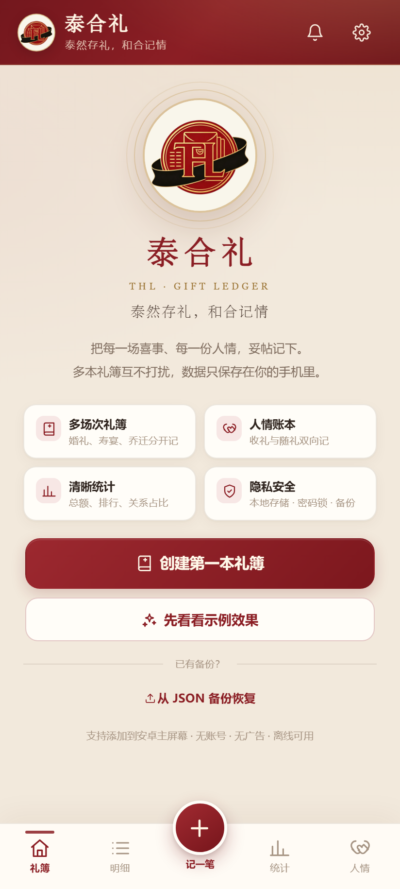
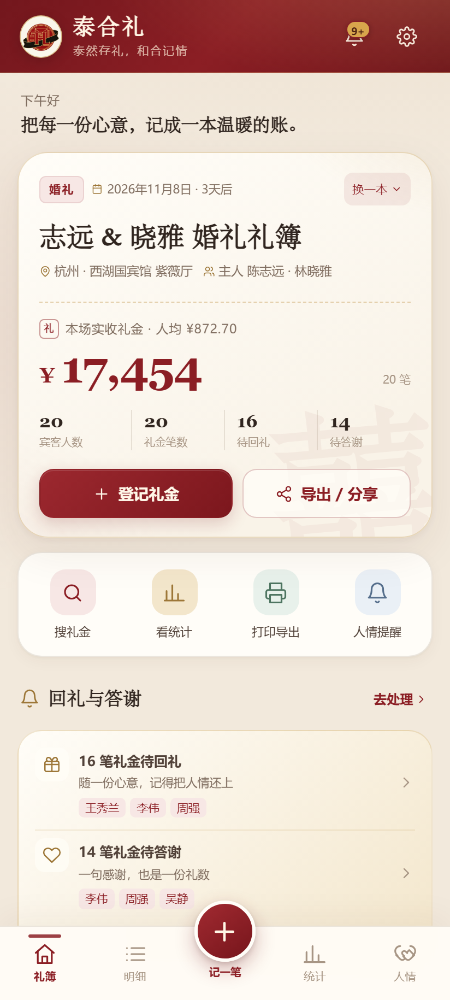
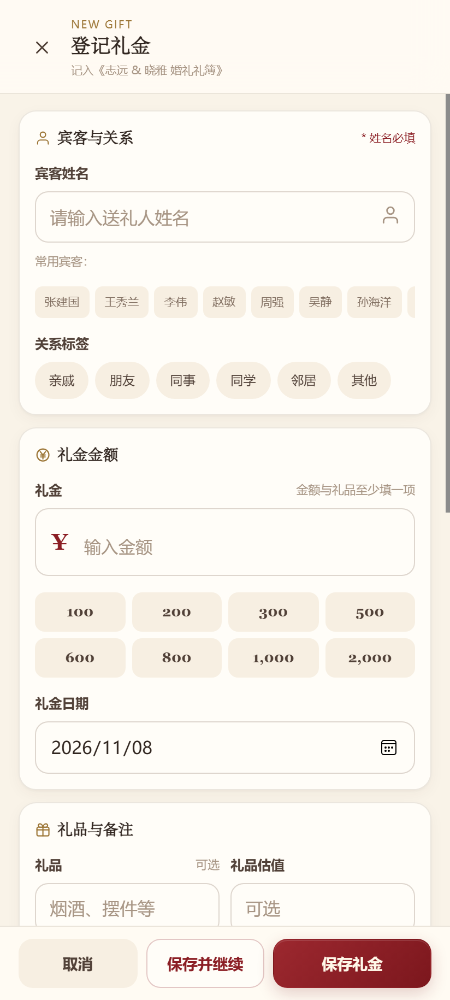
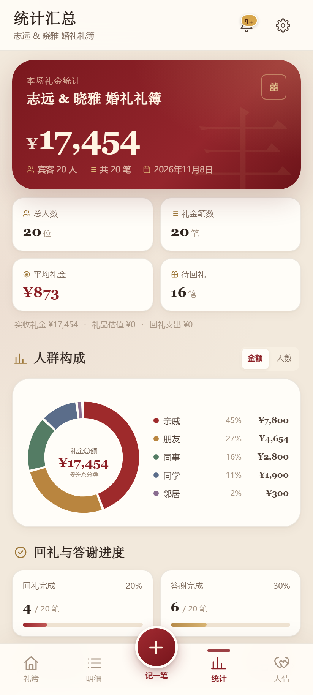
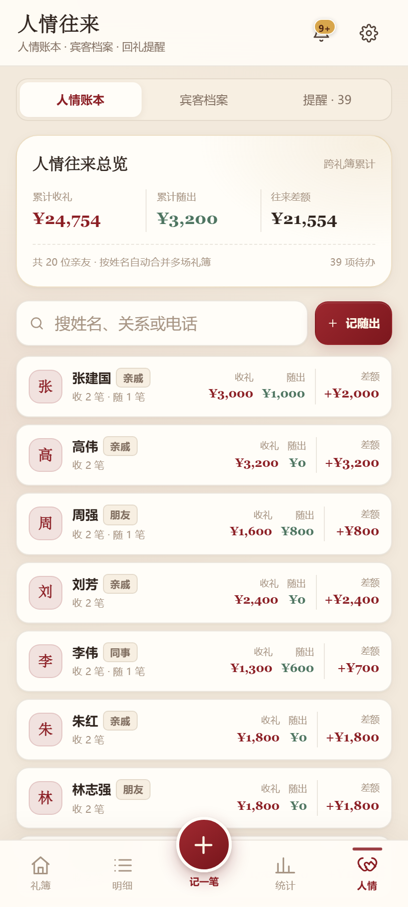
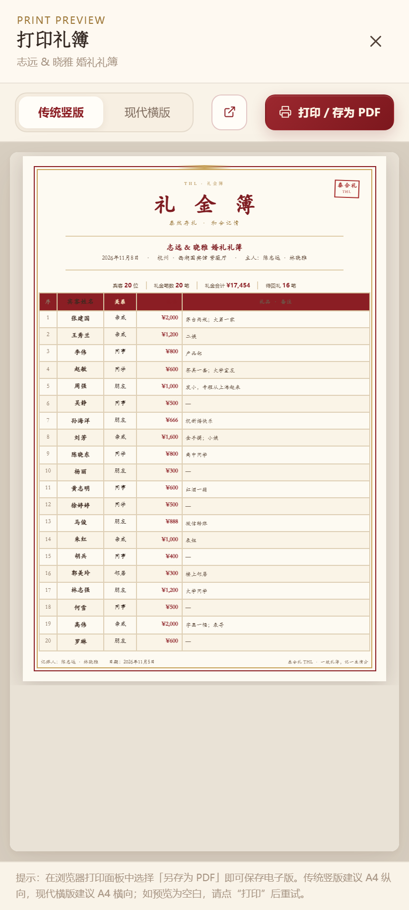
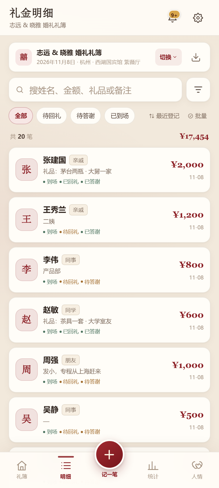
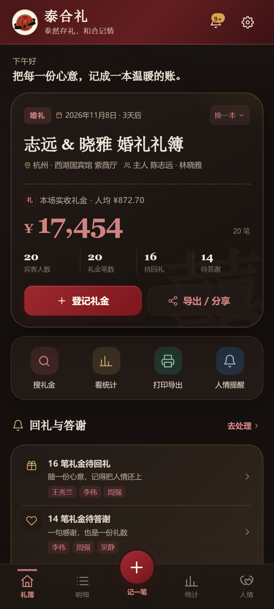
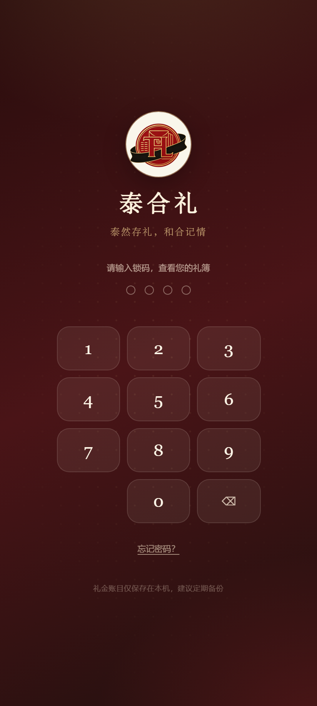

# 泰合礼（THL）礼金簿

<p align="center">
  
</p>

<p align="center"><strong>泰然存礼，和合记情</strong></p>

一个专为喜事礼金与长期人情往来设计的本地优先应用：婚礼、寿宴、乔迁、满月、升学、开业都能分开记账；支持手机拍照存证、回礼答谢、Excel、图片礼单、A4 打印、只读分享和完整备份。

- **无需账号，无需联网，礼金数据不上传**
- **移动端优先，适合长辈使用的清晰大字号界面**
- **可安装 PWA；也提供单个 HTML 离线文件，传到安卓手机用 Chrome 打开即可**
- **版本：v1.0.0**

> 本项目交付的是 **PWA / 离线 HTML 应用**，不是原生 APK。这样不需要应用商店，也不用安装未知来源的安装包；使用安卓 Chrome 即可运行，并可从浏览器菜单安装到主屏幕。

## 界面预览

> 以下为演示数据，姓名与礼金均为虚构示例。

<table>
  <tr>
    <td align="center"><br><sub>欢迎页</sub></td>
    <td align="center"><br><sub>礼簿首页</sub></td>
    <td align="center"><br><sub>快速登记</sub></td>
  </tr>
  <tr>
    <td align="center"><br><sub>统计与人群占比</sub></td>
    <td align="center"><br><sub>双向人情账本</sub></td>
    <td align="center"><br><sub>传统竖版打印</sub></td>
  </tr>
  <tr>
    <td align="center"><br><sub>礼金明细与批量操作</sub></td>
    <td align="center"><br><sub>夜色主题</sub></td>
    <td align="center"><br><sub>数字密码锁</sub></td>
  </tr>
</table>

---

## 一、在安卓手机上运行

### 方式 A：直接用离线单文件（最快，免安装）

1. 把 `dist/泰合礼-礼金簿.html` 发送到安卓手机（微信文件传输、USB、网盘均可）。
2. 保存到“文件/下载”，在文件管理器中选择 **用 Chrome 打开**。
3. 建议在 Chrome 中打开后选择“添加到主屏幕”，以后从桌面图标进入。

离线单文件已经内联了所有 CSS、JavaScript、Logo 与图标，不会请求网络。数据保存在本机 Chrome 中。

> 提示：请固定使用同一个浏览器打开同一个文件，不要清理 Chrome 的网站数据；更换手机、清除浏览器数据或卸载浏览器前，请先在应用内 **设置 → 数据安全 → 导出完整备份**。微信内置浏览器不适合作为长期记账环境，请用 Chrome。

### 方式 B：安装为 PWA（推荐长期使用）

PWA 的完整安装能力需要 **HTTPS**（或电脑本机 `localhost`）。

1. 将整个项目文件夹部署到任意静态 HTTPS 托管：GitHub Pages、Netlify、Vercel、Cloudflare Pages、自己的网站等。
2. 用 **安卓 Chrome** 打开部署后的地址。
3. 点右上角 `⋮` → **安装应用 / 添加到主屏幕**。
4. 从桌面图标启动，获得独立 App 体验与离线缓存。

服务端不需要 Node、数据库或后端接口，只要能把本目录当静态文件访问即可。

### 方式 C：电脑本地预览 / 局域网试用

```bash
# 在项目文件夹中执行
python -m http.server 8080
```

电脑访问 `http://localhost:8080`。手机访问电脑局域网 IP（如 `http://192.168.1.10:8080`）可以使用，但局域网 HTTP 不被浏览器视为安全上下文，因此 **不能安装 PWA、通讯录选择和系统通知可能受限**。正式安装请使用 HTTPS。

---

## 二、功能

### 核心记账与多场次
- 新建/编辑/删除多本礼簿：婚礼、寿宴、乔迁、满月、升学、开业、自定义类型
- 每场独立记录：宴席日期、地点、主人/东家、礼簿寄语
- 礼金登记：姓名、关系、金额、礼品、礼品估值、日期、备注
- 状态管理：已到场、已回礼、已答谢
- 快捷金额一键点选（可在设置中自定义）
- 常用宾客快速选择；保存礼金时自动沉淀宾客档案
- 手机拍照或从相册选择红包/礼单照片，压缩后保存在本机 IndexedDB
- 保存并继续，适合婚宴现场连续快速登记
- 未保存表单自动存草稿；应用重新打开后可恢复

### 查找、对账与批量操作
- 按姓名、金额、关系、礼品、备注、日期搜索
- 金额高低、日期、姓名、最近登记多方式排序
- 待回礼、待答谢、已到场快速筛选
- 关系筛选
- 批量选择：批量标记回礼/答谢/到场、批量修改关系、批量删除
- 选中后合计自动更新

### 统计与对账
- 本场礼金总额、宾客人数、礼金笔数、平均礼金
- 商品礼品估值、回礼支出、待回礼/待答谢
- 礼品/现金合计与实收说明
- 关系分类占比环形图，可切换“金额 / 人数”
- 送礼排行榜（默认前 10，可展开全部）
- 回礼与答谢完成进度
- 多场喜事历史礼金对比，点击可切换礼簿

### 人情往来（长期账本）
- 跨礼簿按姓名自动合并的人情台账
- 双向记录：我收他/她多少、我随他/她多少、往来差额
- 宾客档案：姓名、电话、关系、自定义标签、备注
- 从手机通讯录批量导入（Android Chrome + HTTPS，使用系统联系人选择器）
- 记录“我随出”：事由、金额、礼品、日期、备注
- 提醒中心：所有待回礼与待答谢
- 设置回礼/答谢提醒日；打开 App 时可按系统通知提示今日提醒
- 导出 `.ics` 到手机日历，关闭 App 也能由系统日历提醒

### 导出、打印与只读分享
- **Excel (.xlsx)**：礼金明细 + 统计汇总，直接在手机生成，无第三方库
- **图片礼单**：高清长图，一键保存/调起系统分享到微信；记录多时自动分页
- **打印**：内置两套 A4 模板
  - 传统竖版国风礼簿（A4 纵向）
  - 现代横版明细表格（A4 横向）
  - 可打印或“另存为 PDF”；支持在新窗口打开
- **只读分享**：生成独立 HTML 礼簿网页，家人打开只能查看、不能修改；可直接分享或保存发送
- 完整 JSON 备份：礼簿、礼金、宾客、人情、日志、照片
- Excel 导入模板下载；支持 `.xlsx` / `.csv` 批量导入旧礼单

### 数据安全与设置
- 本地优先：状态存 `localStorage`，照片存 `IndexedDB`
- 4–8 位数字密码锁；自动锁定；立即锁定
- 自动恢复点（最近 8 个关键节点）+ 手动恢复点
- 导入/删除/清空/恢复前的自动快照
- 操作日志：谁在什么时候新增、修改、删除或批量操作
- 主题：喜庆红 / 雅致白 / 夜色黑
- 大字号模式
- 货币单位：人民币、港币、美元、欧元、英镑或自定义符号
- 自定义关系标签与喜事类型
- 品牌关于页：泰合礼 THL · 泰然存礼，和合记情

---

## 三、数据与隐私

- 没有账号、服务器、埋点或广告；账目不会离开设备，除非你主动导出/分享文件。
- **密码锁只是界面访问锁**，数据未加密。设备持有者通过系统级手段仍可能读取浏览器数据，请配合手机锁屏使用。
- 浏览器清理缓存/网站数据、无痕模式、卸载浏览器或更换手机都可能造成数据丢失。**每次办完喜事后请导出一份 JSON 完整备份**，并保存到电脑或私人网盘。
- 恢复点保存在本机，不能代替外部备份；恢复点不包含照片。
- 照片会先压缩到最长边约 1500px，再保存到 IndexedDB。
- 通讯录只在用户主动点击导入并确认系统选择时读取，且只保存所选姓名与电话。
- 生成文件时所有操作都在本机完成。

---

## 四、目录结构

```text
thl-gift-book/
├─ index.html                  # 应用入口（PWA）
├─ manifest.webmanifest        # PWA 清单
├─ sw.js                       # 离线缓存 Service Worker
├─ css/app.css                 # 全部样式
├─ js/                         # 无第三方依赖的原生 JavaScript
│  ├─ core.js                  # 数据模型、本地存储、照片、备份、锁码
│  ├─ files.js                 # Excel/CSV 导入导出、ZIP、JSON 备份
│  ├─ export.js                # 打印、图片礼单、只读分享、ICS
│  ├─ ui.js                    # 页面骨架、弹层、导航、锁屏
│  ├─ home.js                  # 首页、礼簿
│  ├─ records.js               # 明细、登记表单、批量操作
│  ├─ stats.js                 # 统计与历史对比
│  ├─ people.js                # 人情、宾客、提醒、通讯录
│  ├─ settings.js              # 设置
│  ├─ tools.js                 # 导入导出、快照、操作日志、安装
│  └─ app.js                   # 启动
├─ assets/                     # 用户提供的品牌 Logo、PWA 图标
├─ dist/
│  └─ 泰合礼-礼金簿.html        # 所有资源内联的离线单文件（约 1.1 MB）
└─ 使用说明.txt                 # 手机端使用简版说明
```

重新生成单文件：

```bash
python scripts/build_single_html.py
```

---

## 五、已验证

- 412×915、360×800 安卓手机尺寸布局；360px + 大字号无横向溢出
- 新增礼金、保存并继续、编辑、删除、搜索、筛选、批量修改/删除
- 多礼簿切换、新建、清空、删除
- 拍照/相册选择、照片本地存储与详情回显
- 草稿自动保存与重新打开恢复
- 密码锁开启、错误锁码、解锁、关闭锁码
- JSON 备份恢复、自动恢复点、操作日志
- `.xlsx` 生成并用 openpyxl 校验；压缩 `.xlsx` 与 CSV 解析导入
- A4 传统/现代打印预览
- 图片礼单生成
- 只读礼簿独立页面
- Service Worker 注册；断网后刷新仍能打开
- 单文件通过 `file://` 打开；localStorage、IndexedDB、照片、Excel 解析均正常
- PWA Manifest 与安装前置条件检查通过

---

## 六、已知边界

- 只读分享是**离线 HTML 文件**，不是需要服务器的实时协同链接；家人打开时看到的是导出时的快照。
- 联系人选择、系统通知、PWA 安装依赖 Android Chrome 与安全上下文（HTTPS/localhost）。通过单文件 `file://` 打开时，这几项能力可能被浏览器限制，应用内会给出说明。
- 本地通知只在 App 打开时检查并提示；需要关掉 App 仍提醒时，请使用“导出到手机日历”。
- 应用不做云端同步；跨手机迁移请使用完整 JSON 备份。
- 密码锁不是数据库加密，详见隐私说明。

---

## 七、设计说明

- 品牌 Logo 来自用户提供的原始图片，已裁切生成 THL 圆形徽章与 Android maskable 图标。
- 品牌口号：**泰然存礼，和合记情**。
- 主色取中国朱砂红与礼金金，搭配暖米白纸张质感；三种主题均可切换。
- 字体全部使用系统中文字体，不依赖任何 CDN 或外部资源。

愿每一份心意，都被温柔记住。
